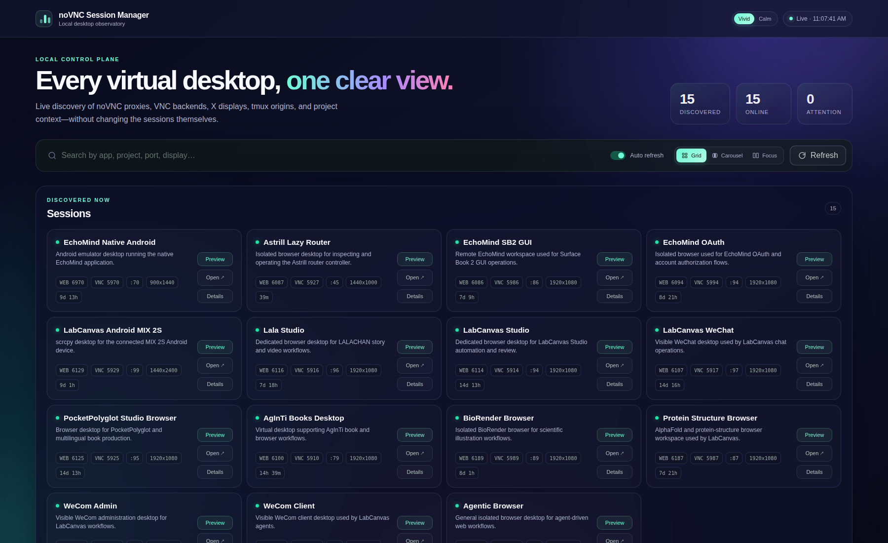
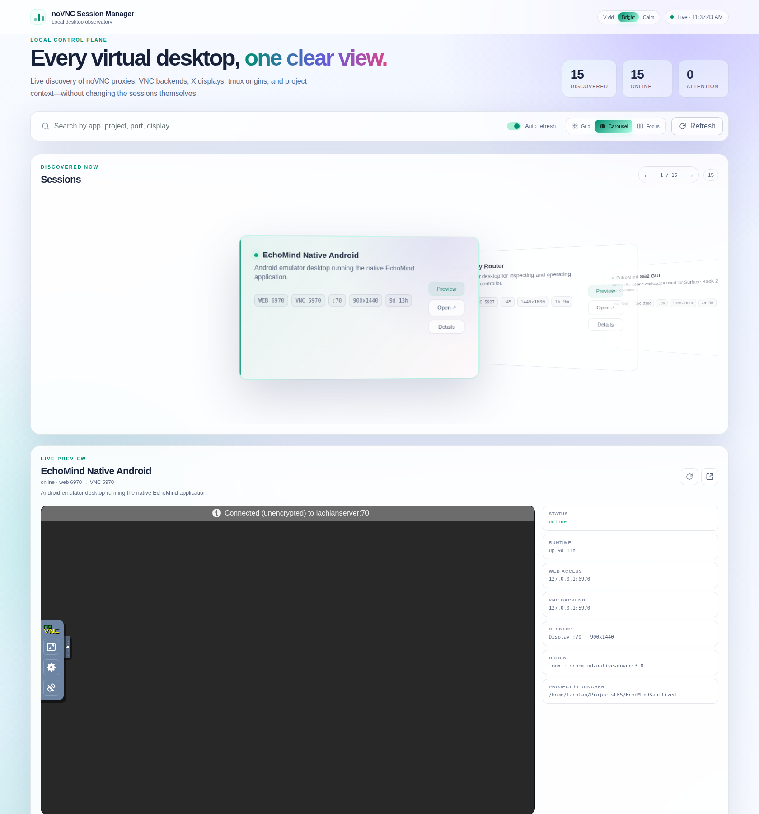
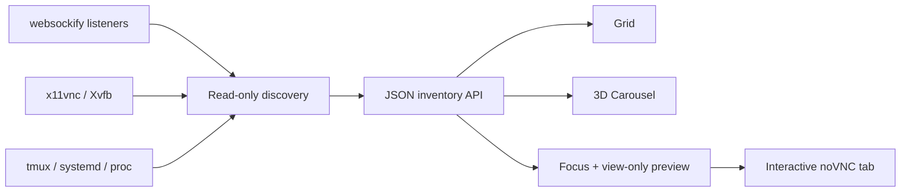

[English](README.md) · [العربية](i18n/README.ar.md) · [Español](i18n/README.es.md) · [Français](i18n/README.fr.md) · [日本語](i18n/README.ja.md) · [한국어](i18n/README.ko.md) · [Tiếng Việt](i18n/README.vi.md) · [中文 (简体)](i18n/README.zh-Hans.md) · [中文（繁體）](i18n/README.zh-Hant.md) · [Deutsch](i18n/README.de.md) · [Русский](i18n/README.ru.md)

[](https://lazying.art)

# noVNC Session Manager

*One elegant local control plane for every noVNC desktop on a Linux workstation.*

[](https://www.python.org/)
[](https://www.kernel.org/)
[](https://github.com/novnc/noVNC)
[](LICENSE)
[](https://github.com/sponsors/lachlanchen)

noVNC Session Manager dynamically discovers active `websockify`, VNC, X11/Xvfb,
tmux, and systemd relationships. It turns a workstation full of isolated virtual
desktops into a clean, searchable dashboard with health checks, source context,
view-only live previews, and one-click interactive opening.

| Donate | PayPal | Stripe |
| --- | --- | --- |
| [](https://chat.lazying.art/donate) | [](https://paypal.me/RongzhouChen) | [](https://buy.stripe.com/aFadR8gIaflgfQV6T4fw400) |



<details>
<summary><strong>Compiz/Vista-inspired 3D carousel</strong></summary>



</details>

## What it gives you

- **Dynamic discovery** — new noVNC listeners appear automatically; no static
  inventory is required.
- **Three purposeful views** — Grid for density, Carousel for elegant browsing
  with a live session inspector, and Focus for a large live preview.
- **Three persistent themes** — vivid color by default, a bright Light-style
  workspace, and a quiet Calm theme.
- **Safe previewing** — only one lazy-loaded, view-only VNC connection is opened
  at a time.
- **Source-aware details** — web/VNC ports, X display, framebuffer size, PID,
  uptime, tmux pane, systemd unit, launcher, and project location.
- **Health at both layers** — the dashboard tests the noVNC HTTP frontend and
  the underlying VNC TCP backend independently.
- **Local-first operation** — the service binds to `127.0.0.1` and never stops,
  restarts, or mutates discovered desktops.
- **Desktop integration** — install an Applications-menu GUI and a
  restart-on-failure user service that can run before login.

## How it works



The backend uses only the Python standard library plus common Linux commands.
It groups forked `websockify` workers into one endpoint, follows each proxy to
its VNC backend and X display, and enriches the result with tmux/systemd/process
metadata. Friendly names and descriptions are optional overlays from
[`config.json`](config.json); unknown endpoints are still shown.

## Quick start

### Run directly

```bash
git clone https://github.com/lachlanchen/novnc-manager.git
cd novnc-manager
python3 server.py --host 127.0.0.1 --port 7080
```

Open <http://127.0.0.1:7080>.

### Install the GUI and boot-persistent user service

```bash
chmod +x scripts/*.sh
./scripts/install-user-service.sh
```

Then search your Applications menu for **noVNC Session Manager**. The installer
uses the canonical systemd user bus even inside RDP/XRDP sessions. If user
lingering is not enabled, it prints the one-time command required for startup
before login:

```bash
sudo loginctl enable-linger "$USER"
```

The browser launcher prefers Google Chrome app mode and software rendering for
reliable remote-desktop compositing; otherwise it falls back to `xdg-open`.

## Interface

| Mode | Best for | Interaction |
| --- | --- | --- |
| **Grid** | Seeing many sessions at once | Compact cards across the full width |
| **Carousel** | Browsing like Vista Flip 3D / Compiz | Enlarged center card, live preview and full session info |
| **Focus** | Inspecting one desktop | Large lazy-loaded view-only preview |

Select **Open ↗** for a full interactive noVNC tab. Theme and view choices are
stored locally in the browser. They can also be selected in a URL for demos:

```text
http://127.0.0.1:7080/?view=carousel&theme=bright
```

## Configuration

Edit [`config.json`](config.json) to attach stable names, descriptions, project
paths, or ordering priorities to known web ports:

```json
{
  "ports": {
    "6087": {
      "name": "Router Console",
      "purpose": "Isolated browser for router administration.",
      "project": "/home/user/Projects/router-console",
      "priority": 80
    }
  }
}
```

The scanner remains dynamic: removing every override does not disable
discovery.

## API

| Endpoint | Purpose |
| --- | --- |
| `GET /healthz` | Lightweight manager health probe |
| `GET /api/instances` | Current session inventory and two-layer health |

## Project map

| Path | Role |
| --- | --- |
| [`server.py`](server.py) | Discovery engine and localhost HTTP server |
| [`static/`](static/) | Responsive dashboard, themes, and view modes |
| [`config.json`](config.json) | Optional human-friendly session metadata |
| [`scripts/install-user-service.sh`](scripts/install-user-service.sh) | Idempotent per-user installer |
| [`scripts/open-manager.sh`](scripts/open-manager.sh) | Robust desktop GUI launcher |
| [`packaging/`](packaging/) | Portable systemd and desktop-entry templates |
| [`assets/`](assets/) | Icon and interface screenshots |

## Validation

```bash
bash -n scripts/*.sh
python3 -m py_compile server.py
python3 -m json.tool config.json >/dev/null
node --check static/app.js
curl --fail http://127.0.0.1:7080/healthz
curl --fail http://127.0.0.1:7080/api/instances | python3 -m json.tool
```

The manager is intentionally observational. Lifecycle controls are not inferred
from arbitrary processes because restarting the wrong tmux pane or detached
proxy could destroy application state.

## Citation

If you use noVNC Session Manager in research, cite the repository. GitHub reads
[`CITATION.cff`](CITATION.cff) and shows a **Cite this repository** panel.

```bibtex
@software{chen_novnc_manager_2026,
  author = {Chen, Lachlan},
  title = {noVNC Session Manager: A local control plane for virtual desktops},
  year = {2026},
  url = {https://github.com/lachlanchen/novnc-manager}
}
```

## Status and scope

The project is a working Linux utility tested with `websockify`, noVNC,
`x11vnc`, Xvfb, tmux, systemd user services, Chrome app mode, XRDP, and VNC.
It is not a replacement for authentication or network access control. Keep the
manager and unauthenticated noVNC endpoints on localhost unless you deliberately
place them behind a secure tunnel or authenticated reverse proxy.

Released under the [MIT License](LICENSE). Part of the
[LazyingArt](https://lazying.art) open-source ecosystem.
