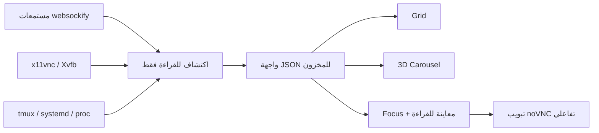

[English](../README.md) · [العربية](README.ar.md) · [Español](README.es.md) · [Français](README.fr.md) · [日本語](README.ja.md) · [한국어](README.ko.md) · [Tiếng Việt](README.vi.md) · [中文 (简体)](README.zh-Hans.md) · [中文（繁體）](README.zh-Hant.md) · [Deutsch](README.de.md) · [Русский](README.ru.md)

[](https://lazying.art)

# noVNC Session Manager

*لوحة تحكم محلية أنيقة لكل أسطح مكتب noVNC على محطة عمل Linux.*

[](https://www.python.org/)
[](https://www.kernel.org/)
[](https://github.com/novnc/noVNC)
[](../LICENSE)
[](https://github.com/sponsors/lachlanchen)

يكتشف noVNC Session Manager ديناميكياً العلاقات بين `websockify` وVNC
وX11/Xvfb وtmux وsystemd. وهو يحوّل عدداً كبيراً من أسطح المكتب الافتراضية
المعزولة إلى لوحة واضحة قابلة للبحث، مع فحص الحالة، ومعلومات مصدر التشغيل،
ومعاينة مباشرة للقراءة فقط، وفتح تفاعلي بنقرة واحدة.

| Donate | PayPal | Stripe |
| --- | --- | --- |
| [](https://chat.lazying.art/donate) | [](https://paypal.me/RongzhouChen) | [](https://buy.stripe.com/aFadR8gIaflgfQV6T4fw400) |


<details>
<summary><strong>عارض ثلاثي الأبعاد مستوحى من Compiz وVista</strong></summary>


</details>

## المزايا

- **اكتشاف ديناميكي** — تظهر مستمعات noVNC الجديدة دون قائمة ثابتة.
- **ثلاثة عروض هادفة** — Grid للكثافة، وCarousel للتصفح مع معاينة ومعلومات حية، وFocus للمعاينة الكبيرة.
- **ثلاث سمات محفوظة** — Vivid هي الافتراضية، وBright للعمل المضيء، وCalm لمظهر أكثر هدوءاً.
- **معاينة آمنة** — اتصال VNC واحد مؤجل التحميل وللقراءة فقط في كل مرة.
- **تفاصيل المصدر** — منافذ Web/VNC وX display والدقة وPID ومدة التشغيل،
  وtmux pane وsystemd unit والمشغّل ومسار المشروع.
- **فحص على مستويين** — اختبار منفصل لواجهة noVNC HTTP وخلفية VNC TCP.
- **محلي أولاً** — الربط مع `127.0.0.1` فقط، من دون تعديل أسطح المكتب.
- **تكامل سطح المكتب** — تطبيق في القائمة وخدمة مستخدم تعمل قبل تسجيل الدخول.

## آلية العمل



تستخدم الخلفية مكتبة Python القياسية وأوامر Linux الشائعة فقط. وهي تجمع عمال
`websockify` المتفرعين، وتتبع كل proxy إلى خلفية VNC وX display، ثم تضيف
بيانات tmux وsystemd والعمليات. يضيف [`config.json`](../config.json) أسماء
وأوصافاً اختيارية، بينما تستمر نقطة النهاية غير المسجلة في الظهور.

## بدء سريع

```bash
git clone https://github.com/lachlanchen/novnc-manager.git
cd novnc-manager
python3 server.py --host 127.0.0.1 --port 7080
```

افتح <http://127.0.0.1:7080>.

لتثبيت الواجهة والخدمة المستمرة عند الإقلاع:

```bash
chmod +x scripts/*.sh
./scripts/install-user-service.sh
```

ابحث بعدها عن **noVNC Session Manager** في قائمة التطبيقات. يستخدم المثبّت
ناقل systemd الصحيح حتى داخل RDP/XRDP. وإذا لم يكن lingering مفعلاً، يعرض
الأمر اللازم للتشغيل قبل تسجيل الدخول:

```bash
sudo loginctl enable-linger "$USER"
```

يفضّل المشغّل Google Chrome بوضع app mode مع الرسم البرمجي لاستقرار العرض
البعيد، ويعود إلى `xdg-open` عند عدم توفره.

## أوضاع الواجهة

| الوضع | الأنسب | التفاعل |
| --- | --- | --- |
| **Grid** | رؤية جلسات كثيرة معاً | بطاقات مدمجة بعرض الصفحة |
| **Carousel** | تصفح بأسلوب Vista Flip 3D / Compiz | العجلة أو النقر أو ← / → |
| **Focus** | فحص سطح مكتب واحد | معاينة كبيرة مؤجلة وللقراءة فقط |

يفتح **Open ↗** تبويب noVNC تفاعلياً بالكامل. تُحفظ السمة وطريقة العرض في
المتصفح، ويمكن اختيارهما أيضاً في الرابط:

```text
http://127.0.0.1:7080/?view=carousel&theme=vivid
```

## الإعداد وAPI

حرّر [`config.json`](../config.json) لإسناد الأسماء والأوصاف ومسارات المشاريع
والأولوية إلى المنافذ المعروفة. يبقى الاكتشاف ديناميكياً حتى بعد حذف كل
التخصيصات.

| نقطة النهاية | الغرض |
| --- | --- |
| `GET /healthz` | فحص خفيف لحالة المدير |
| `GET /api/instances` | المخزون الحالي والحالة على مستويين |

## خريطة المشروع

| المسار | الدور |
| --- | --- |
| [`server.py`](../server.py) | محرك الاكتشاف وخادم HTTP المحلي |
| [`static/`](../static/) | اللوحة المتجاوبة والسمات والأوضاع |
| [`config.json`](../config.json) | بيانات جلسات اختيارية مقروءة |
| [`scripts/install-user-service.sh`](../scripts/install-user-service.sh) | مثبّت مستخدم idempotent |
| [`scripts/open-manager.sh`](../scripts/open-manager.sh) | مشغّل GUI متين |
| [`packaging/`](../packaging/) | قوالب systemd وdesktop-entry محمولة |

## التحقق

```bash
bash -n scripts/*.sh
python3 -m py_compile server.py
python3 -m json.tool config.json >/dev/null
node --check static/app.js
curl --fail http://127.0.0.1:7080/healthz
curl --fail http://127.0.0.1:7080/api/instances | python3 -m json.tool
```

المدير رصدي عن قصد. لا يستنتج أوامر دورة الحياة من عمليات عشوائية، لأن إعادة
تشغيل tmux pane أو proxy خاطئ قد تفقد حالة التطبيق.

## الاستشهاد

إذا استخدمت noVNC Session Manager في البحث، فاستشهد بهذا المستودع. يقرأ GitHub
ملف [`CITATION.cff`](../CITATION.cff) ويعرض لوحة
**Cite this repository**.

```bibtex
@software{chen_novnc_manager_2026,
  author = {Chen, Lachlan},
  title = {noVNC Session Manager: A local control plane for virtual desktops},
  year = {2026},
  url = {https://github.com/lachlanchen/novnc-manager}
}
```

## الحالة والنطاق

تم اختباره مع `websockify` وnoVNC و`x11vnc` وXvfb وtmux وخدمات مستخدم
systemd وChrome app mode وXRDP وVNC. لا يحل محل المصادقة أو التحكم بالوصول.
أبقِ المدير ونقاط noVNC غير المصادق عليها على localhost ما لم تستخدم نفقاً
آمناً أو reverse proxy بمصادقة.

منشور وفق [ترخيص MIT](../LICENSE) وجزء من منظومة
[LazyingArt](https://lazying.art) مفتوحة المصدر.
