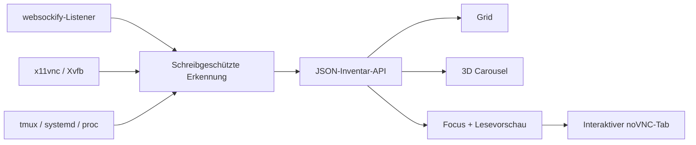

[English](../README.md) · [العربية](README.ar.md) · [Español](README.es.md) · [Français](README.fr.md) · [日本語](README.ja.md) · [한국어](README.ko.md) · [Tiếng Việt](README.vi.md) · [中文 (简体)](README.zh-Hans.md) · [中文（繁體）](README.zh-Hant.md) · [Deutsch](README.de.md) · [Русский](README.ru.md)

[](https://lazying.art)

# noVNC Session Manager

*Eine elegante lokale Schaltzentrale für alle noVNC-Desktops einer Linux-Workstation.*

[](https://www.python.org/)
[](https://www.kernel.org/)
[](https://github.com/novnc/noVNC)
[](../LICENSE)
[](https://github.com/sponsors/lachlanchen)

noVNC Session Manager erkennt laufende Beziehungen zwischen `websockify`, VNC,
X11/Xvfb, tmux und systemd dynamisch. Viele isolierte virtuelle Desktops werden
zu einem klaren, durchsuchbaren Dashboard mit Zustandsprüfung, Herkunft,
schreibgeschützter Live-Vorschau und interaktivem Öffnen per Klick.

<!-- support:start -->
[](https://github.com/sponsors/lachlanchen)
[](https://chat.lazying.art/donate)
[](https://paypal.me/RongzhouChen)
[](https://buy.stripe.com/aFadR8gIaflgfQV6T4fw400)
<!-- support:end -->


<details>
<summary><strong>Von Compiz und Vista inspiriertes 3D-Karussell</strong></summary>


</details>

## Funktionen

- **Dynamische Erkennung** — neue noVNC-Listener erscheinen ohne statische Liste.
- **Drei gezielte Ansichten** — Grid für Dichte, Carousel mit Live-Vorschau und Informationen, Focus für große Vorschau.
- **Drei dauerhafte Themes** — standardmäßig Vivid, dazu das helle Bright und das ruhige Calm.
- **Sichere Vorschau** — jeweils nur eine verzögert geladene VNC-Verbindung im Lesemodus.
- **Herkunftsdetails** — Web/VNC-Ports, X display, Auflösung, PID, Laufzeit,
  tmux pane, systemd unit, Starter und Projektpfad.
- **Zweistufige Prüfung** — noVNC-HTTP-Frontend und VNC-TCP-Backend werden getrennt getestet.
- **Local first** — Bindung nur an `127.0.0.1`, ohne erkannte Desktops zu verändern.
- **Desktop-Integration** — Anwendungsstarter und vor dem Login verfügbarer Benutzerdienst.

## Funktionsweise



Das Backend benötigt nur die Python-Standardbibliothek und übliche
Linux-Befehle. Es gruppiert geforkte `websockify`-Worker, verfolgt Proxys bis
zum VNC-Backend und X display und ergänzt tmux-, systemd- und Prozessdaten.
[`config.json`](../config.json) liefert optionale Namen und Beschreibungen;
unbekannte Endpunkte werden weiterhin angezeigt.

## Schnellstart

```bash
git clone https://github.com/lachlanchen/novnc-manager.git
cd novnc-manager
python3 server.py --host 127.0.0.1 --port 7080
```

Öffne <http://127.0.0.1:7080>.

GUI und boot-persistenten Benutzerdienst installieren:

```bash
chmod +x scripts/*.sh
./scripts/install-user-service.sh
```

Danach im Anwendungsmenü nach **noVNC Session Manager** suchen. Der Installer
verwendet auch in RDP/XRDP den kanonischen systemd-Benutzerbus. Falls lingering
deaktiviert ist, zeigt er diesen Befehl für den Start vor dem Login:

```bash
sudo loginctl enable-linger "$USER"
```

Der GUI-Starter bevorzugt Google Chrome im app mode mit Software-Rendering für
stabile Remote-Komposition und fällt andernfalls auf `xdg-open` zurück.

## Oberflächenmodi

| Modus | Geeignet für | Bedienung |
| --- | --- | --- |
| **Grid** | Viele Sitzungen gleichzeitig | Kompakte Karten über die ganze Breite |
| **Carousel** | Navigation wie Vista Flip 3D / Compiz | Mausrad, Klick oder ← / → |
| **Focus** | Einen Desktop untersuchen | Große verzögert geladene Lesevorschau |

**Open ↗** öffnet einen vollständig interaktiven noVNC-Tab. Theme und Ansicht
werden im Browser gespeichert und lassen sich auch per URL wählen:

```text
http://127.0.0.1:7080/?view=carousel&theme=vivid
```

## Konfiguration und API

In [`config.json`](../config.json) können bekannte Ports Namen, Beschreibungen,
Projektpfade und Prioritäten erhalten. Die Erkennung bleibt auch ohne alle
Überschreibungen dynamisch.

| Endpunkt | Zweck |
| --- | --- |
| `GET /healthz` | Leichte Zustandsprüfung des Managers |
| `GET /api/instances` | Aktuelles Inventar und zweistufiger Zustand |

## Projektübersicht

| Pfad | Rolle |
| --- | --- |
| [`server.py`](../server.py) | Erkennungsengine und lokaler HTTP-Server |
| [`static/`](../static/) | Responsives Dashboard, Themes und Ansichten |
| [`config.json`](../config.json) | Optionale lesbare Sitzungsmetadaten |
| [`scripts/install-user-service.sh`](../scripts/install-user-service.sh) | Idempotenter Benutzerinstaller |
| [`scripts/open-manager.sh`](../scripts/open-manager.sh) | Robuster Desktop-GUI-Starter |
| [`packaging/`](../packaging/) | Portable systemd- und desktop-entry-Vorlagen |

## Validierung

```bash
bash -n scripts/*.sh
python3 -m py_compile server.py
python3 -m json.tool config.json >/dev/null
node --check static/app.js
curl --fail http://127.0.0.1:7080/healthz
curl --fail http://127.0.0.1:7080/api/instances | python3 -m json.tool
```

Der Manager bleibt absichtlich beobachtend. Lebenszyklusaktionen werden nicht
aus beliebigen Prozessen erraten, da ein falscher Neustart eines tmux pane oder
detached Proxy Anwendungszustand zerstören könnte.

## Zitation

Wenn noVNC Session Manager in Forschung verwendet wird, bitte dieses Repository
zitieren. GitHub liest [`CITATION.cff`](../CITATION.cff) und zeigt
**Cite this repository** an.

```bibtex
@software{chen_novnc_manager_2026,
  author = {Chen, Lachlan},
  title = {noVNC Session Manager: A local control plane for virtual desktops},
  year = {2026},
  url = {https://github.com/lachlanchen/novnc-manager}
}
```

## Status und Umfang

Getestet mit `websockify`, noVNC, `x11vnc`, Xvfb, tmux,
systemd-Benutzerdiensten, Chrome app mode, XRDP und VNC. Das Projekt ersetzt
weder Authentifizierung noch Zugriffskontrolle. Manager und unauthentifizierte
noVNC-Endpunkte sollten ohne sicheren Tunnel oder authentifizierten Reverse
Proxy ausschließlich auf localhost bleiben.

Veröffentlicht unter der [MIT-Lizenz](../LICENSE) als Teil des
[LazyingArt](https://lazying.art)-Open-Source-Ökosystems.
