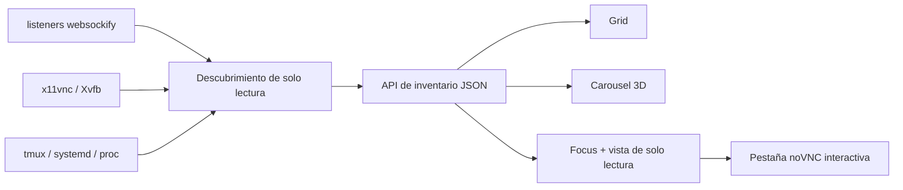

[English](../README.md) · [العربية](README.ar.md) · [Español](README.es.md) · [Français](README.fr.md) · [日本語](README.ja.md) · [한국어](README.ko.md) · [Tiếng Việt](README.vi.md) · [中文 (简体)](README.zh-Hans.md) · [中文（繁體）](README.zh-Hant.md) · [Deutsch](README.de.md) · [Русский](README.ru.md)

[](https://lazying.art)

# noVNC Session Manager

*Un centro de control local y elegante para todos los escritorios noVNC de una estación Linux.*

[](https://www.python.org/)
[](https://www.kernel.org/)
[](https://github.com/novnc/noVNC)
[](../LICENSE)
[](https://github.com/sponsors/lachlanchen)

noVNC Session Manager descubre dinámicamente las relaciones entre `websockify`,
VNC, X11/Xvfb, tmux y systemd. Convierte muchos escritorios virtuales aislados
en un panel claro y buscable, con comprobación de salud, contexto de origen,
vista previa en vivo de solo lectura y apertura interactiva con un clic.

<!-- support:start -->
[](https://github.com/sponsors/lachlanchen)
[](https://chat.lazying.art/donate)
[](https://paypal.me/RongzhouChen)
[](https://buy.stripe.com/aFadR8gIaflgfQV6T4fw400)
<!-- support:end -->


<details>
<summary><strong>Carrusel 3D inspirado en Compiz y Vista</strong></summary>


</details>

## Qué ofrece

- **Descubrimiento dinámico**: los nuevos listeners noVNC aparecen sin mantener un inventario fijo.
- **Tres vistas específicas**: Grid para densidad, Carousel con vista previa e información en vivo y Focus para una vista previa grande.
- **Tres temas persistentes**: Vivid es el predeterminado, Bright aporta luminosidad y Calm ofrece una apariencia tranquila.
- **Vista previa segura**: solo se carga una conexión VNC de solo lectura a la vez.
- **Detalles de origen**: puertos Web/VNC, X display, resolución, PID, tiempo activo,
  tmux pane, systemd unit, lanzador y ubicación del proyecto.
- **Salud en dos capas**: comprueba por separado el frontend HTTP noVNC y el backend TCP VNC.
- **Local primero**: se enlaza a `127.0.0.1` y nunca modifica los escritorios encontrados.
- **Integración de escritorio**: instala una GUI en el menú y un servicio de usuario previo al inicio de sesión.

## Cómo funciona



El backend usa únicamente la biblioteca estándar de Python y comandos Linux
habituales. Agrupa workers `websockify` bifurcados, sigue cada proxy hasta su
backend VNC y X display, y añade metadatos de tmux, systemd y procesos.
[`config.json`](../config.json) permite superponer nombres y descripciones;
los endpoints no registrados también se muestran.

## Inicio rápido

```bash
git clone https://github.com/lachlanchen/novnc-manager.git
cd novnc-manager
python3 server.py --host 127.0.0.1 --port 7080
```

Abre <http://127.0.0.1:7080>.

Para instalar la GUI y el servicio persistente al arrancar:

```bash
chmod +x scripts/*.sh
./scripts/install-user-service.sh
```

Busca **noVNC Session Manager** en el menú de aplicaciones. El instalador usa el
bus de usuario systemd correcto incluso dentro de RDP/XRDP. Si lingering no está
habilitado, muestra el comando necesario para iniciar antes del login:

```bash
sudo loginctl enable-linger "$USER"
```

El lanzador prefiere Google Chrome en app mode con renderizado por software para
una composición remota estable; si no está disponible, utiliza `xdg-open`.

## Modos de interfaz

| Modo | Ideal para | Interacción |
| --- | --- | --- |
| **Grid** | Ver muchas sesiones a la vez | Tarjetas compactas a todo lo ancho |
| **Carousel** | Navegar como Vista Flip 3D / Compiz | Rueda, clic o ← / → |
| **Focus** | Inspeccionar un escritorio | Vista grande, diferida y de solo lectura |

**Open ↗** abre una pestaña noVNC plenamente interactiva. El tema y la vista se
guardan en el navegador y también pueden elegirse mediante URL:

```text
http://127.0.0.1:7080/?view=carousel&theme=vivid
```

## Configuración y API

Edita [`config.json`](../config.json) para asignar nombres, descripciones, rutas
de proyecto y prioridades a puertos conocidos. El escáner sigue siendo dinámico
aunque elimines todas las sobreescrituras.

| Endpoint | Función |
| --- | --- |
| `GET /healthz` | Comprobación ligera del gestor |
| `GET /api/instances` | Inventario actual y salud en dos capas |

## Mapa del proyecto

| Ruta | Función |
| --- | --- |
| [`server.py`](../server.py) | Motor de descubrimiento y servidor HTTP local |
| [`static/`](../static/) | Panel adaptable, temas y modos |
| [`config.json`](../config.json) | Metadatos legibles opcionales |
| [`scripts/install-user-service.sh`](../scripts/install-user-service.sh) | Instalador idempotente por usuario |
| [`scripts/open-manager.sh`](../scripts/open-manager.sh) | Lanzador GUI robusto |
| [`packaging/`](../packaging/) | Plantillas portátiles systemd y desktop-entry |

## Validación

```bash
bash -n scripts/*.sh
python3 -m py_compile server.py
python3 -m json.tool config.json >/dev/null
node --check static/app.js
curl --fail http://127.0.0.1:7080/healthz
curl --fail http://127.0.0.1:7080/api/instances | python3 -m json.tool
```

El gestor es deliberadamente observacional. No deduce controles de ciclo de
vida de procesos arbitrarios, porque reiniciar el tmux pane o proxy equivocado
podría destruir el estado de una aplicación.

## Cita

Si utilizas noVNC Session Manager en investigación, cita el repositorio. GitHub
lee [`CITATION.cff`](../CITATION.cff) y muestra el panel
**Cite this repository**.

```bibtex
@software{chen_novnc_manager_2026,
  author = {Chen, Lachlan},
  title = {noVNC Session Manager: A local control plane for virtual desktops},
  year = {2026},
  url = {https://github.com/lachlanchen/novnc-manager}
}
```

## Estado y alcance

Probado con `websockify`, noVNC, `x11vnc`, Xvfb, tmux, servicios de usuario
systemd, Chrome app mode, XRDP y VNC. No sustituye autenticación ni control de
acceso. Mantén el gestor y los endpoints no autenticados en localhost salvo que
uses un túnel seguro o un proxy inverso autenticado.

Publicado bajo la [Licencia MIT](../LICENSE) como parte del ecosistema abierto
[LazyingArt](https://lazying.art).
