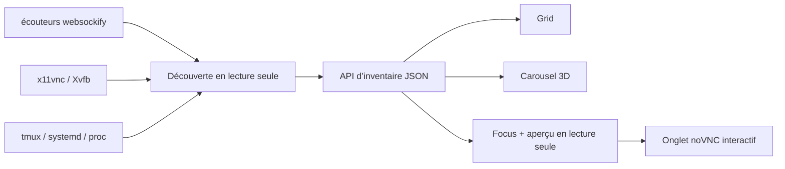

[English](../README.md) · [العربية](README.ar.md) · [Español](README.es.md) · [Français](README.fr.md) · [日本語](README.ja.md) · [한국어](README.ko.md) · [Tiếng Việt](README.vi.md) · [中文 (简体)](README.zh-Hans.md) · [中文（繁體）](README.zh-Hant.md) · [Deutsch](README.de.md) · [Русский](README.ru.md)

[](https://github.com/lachlanchen/lachlanchen/blob/main/figs/banner.png)

# noVNC Session Manager

*Un centre de contrôle local et élégant pour tous les bureaux noVNC d’une station Linux.*

[](https://www.python.org/)
[](https://www.kernel.org/)
[](https://github.com/novnc/noVNC)
[](../LICENSE)
[](https://github.com/sponsors/lachlanchen)

noVNC Session Manager découvre dynamiquement les relations entre `websockify`,
VNC, X11/Xvfb, tmux et systemd. Il transforme une multitude de bureaux virtuels
isolés en un tableau de bord clair et consultable, avec contrôles de santé,
contexte de lancement, aperçu direct en lecture seule et ouverture interactive.

| Donate | PayPal | Stripe |
| --- | --- | --- |
| [](https://chat.lazying.art/donate) | [](https://paypal.me/RongzhouChen) | [](https://buy.stripe.com/aFadR8gIaflgfQV6T4fw400) |


<details>
<summary><strong>Carrousel 3D inspiré de Compiz et Vista</strong></summary>


</details>

## Ce que vous obtenez

- **Découverte dynamique** — les nouveaux écouteurs noVNC apparaissent sans inventaire fixe.
- **Trois vues dédiées** — Grid pour la densité, Carousel avec aperçu et informations en direct, Focus pour un grand aperçu.
- **Trois thèmes persistants** — Vivid par défaut, Bright pour la lumière et Calm plus discret.
- **Aperçu sûr** — une seule connexion VNC différée et en lecture seule à la fois.
- **Détails d’origine** — ports Web/VNC, X display, résolution, PID, durée,
  tmux pane, systemd unit, lanceur et emplacement du projet.
- **Santé sur deux couches** — tests séparés du frontal HTTP noVNC et du backend TCP VNC.
- **Local d’abord** — liaison à `127.0.0.1`, sans modifier les bureaux découverts.
- **Intégration au bureau** — GUI dans le menu et service utilisateur disponible avant connexion.

## Fonctionnement



Le backend n’utilise que la bibliothèque standard Python et des commandes Linux
courantes. Il regroupe les workers `websockify` issus d’un fork, suit chaque
proxy jusqu’au backend VNC et au X display, puis ajoute les métadonnées tmux,
systemd et processus. [`config.json`](../config.json) fournit des noms et
descriptions facultatifs ; les endpoints inconnus restent visibles.

## Démarrage rapide

```bash
git clone https://github.com/lachlanchen/novnc-manager.git
cd novnc-manager
python3 server.py --host 127.0.0.1 --port 7080
```

Ouvrez <http://127.0.0.1:7080>.

Pour installer la GUI et le service persistant au démarrage :

```bash
chmod +x scripts/*.sh
./scripts/install-user-service.sh
```

Cherchez ensuite **noVNC Session Manager** dans le menu des applications.
L’installateur emploie le bus utilisateur systemd canonique même sous RDP/XRDP.
Si lingering n’est pas activé, il affiche la commande nécessaire :

```bash
sudo loginctl enable-linger "$USER"
```

Le lanceur privilégie Google Chrome en app mode avec rendu logiciel pour une
composition distante stable, puis utilise `xdg-open` en solution de repli.

## Modes d’interface

| Mode | Idéal pour | Interaction |
| --- | --- | --- |
| **Grid** | Voir beaucoup de sessions | Cartes compactes sur toute la largeur |
| **Carousel** | Parcourir façon Vista Flip 3D / Compiz | Molette, clic ou ← / → |
| **Focus** | Examiner un bureau | Grand aperçu différé en lecture seule |

**Open ↗** ouvre un onglet noVNC entièrement interactif. Le thème et la vue sont
conservés dans le navigateur et peuvent aussi être choisis dans l’URL :

```text
http://127.0.0.1:7080/?view=carousel&theme=vivid
```

## Configuration et API

Modifiez [`config.json`](../config.json) pour associer noms, descriptions,
chemins de projet et priorités aux ports connus. La découverte reste dynamique
même sans aucune surcharge.

| Endpoint | Rôle |
| --- | --- |
| `GET /healthz` | Contrôle de santé léger du gestionnaire |
| `GET /api/instances` | Inventaire courant et santé sur deux couches |

## Carte du projet

| Chemin | Rôle |
| --- | --- |
| [`server.py`](../server.py) | Moteur de découverte et serveur HTTP local |
| [`static/`](../static/) | Tableau responsive, thèmes et vues |
| [`config.json`](../config.json) | Métadonnées lisibles facultatives |
| [`scripts/install-user-service.sh`](../scripts/install-user-service.sh) | Installateur utilisateur idempotent |
| [`scripts/open-manager.sh`](../scripts/open-manager.sh) | Lanceur GUI robuste |
| [`packaging/`](../packaging/) | Modèles portables systemd et desktop-entry |

## Validation

```bash
bash -n scripts/*.sh
python3 -m py_compile server.py
python3 -m json.tool config.json >/dev/null
node --check static/app.js
curl --fail http://127.0.0.1:7080/healthz
curl --fail http://127.0.0.1:7080/api/instances | python3 -m json.tool
```

Le gestionnaire est volontairement observateur. Il ne déduit pas de commandes
de cycle de vie depuis des processus arbitraires, car redémarrer le mauvais
tmux pane ou proxy détaché peut détruire l’état applicatif.

## Citation

Si vous utilisez noVNC Session Manager en recherche, citez ce dépôt. GitHub lit
[`CITATION.cff`](../CITATION.cff) et affiche le panneau
**Cite this repository**.

```bibtex
@software{chen_novnc_manager_2026,
  author = {Chen, Lachlan},
  title = {noVNC Session Manager: A local control plane for virtual desktops},
  year = {2026},
  url = {https://github.com/lachlanchen/novnc-manager}
}
```

## État et périmètre

Testé avec `websockify`, noVNC, `x11vnc`, Xvfb, tmux, les services utilisateur
systemd, Chrome app mode, XRDP et VNC. Ce projet ne remplace ni authentification
ni contrôle d’accès. Gardez le gestionnaire et les endpoints noVNC non
authentifiés sur localhost, sauf tunnel sécurisé ou proxy inverse authentifié.

Distribué sous [licence MIT](../LICENSE) au sein de l’écosystème open source
[LazyingArt](https://lazying.art).
