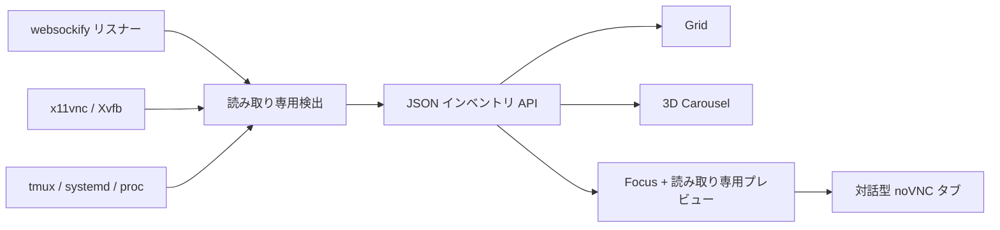

[English](../README.md) · [العربية](README.ar.md) · [Español](README.es.md) · [Français](README.fr.md) · [日本語](README.ja.md) · [한국어](README.ko.md) · [Tiếng Việt](README.vi.md) · [中文 (简体)](README.zh-Hans.md) · [中文（繁體）](README.zh-Hant.md) · [Deutsch](README.de.md) · [Русский](README.ru.md)

[](https://lazying.art)

# noVNC Session Manager

*Linux ワークステーション上のすべての noVNC デスクトップを、ひとつの洗練されたローカル画面へ。*

[](https://www.python.org/)
[](https://www.kernel.org/)
[](https://github.com/novnc/noVNC)
[](../LICENSE)
[](https://github.com/sponsors/lachlanchen)

noVNC Session Manager は、稼働中の `websockify`、VNC、X11/Xvfb、tmux、
systemd の関係を動的に検出します。多数の隔離された仮想デスクトップを、
検索可能なダッシュボードへ整理し、ヘルスチェック、起動元の情報、読み取り専用
ライブプレビュー、ワンクリックの対話表示を提供します。

<!-- support:start -->
[](https://github.com/sponsors/lachlanchen)
[](https://chat.lazying.art/donate)
[](https://paypal.me/RongzhouChen)
[](https://buy.stripe.com/aFadR8gIaflgfQV6T4fw400)
<!-- support:end -->


<details>
<summary><strong>Compiz / Vista に着想を得た 3D カルーセル</strong></summary>


</details>

## 主な機能

- **動的検出** — 新しい noVNC リスナーは自動で現れ、固定台帳は不要です。
- **目的別の 3 表示** — 高密度な Grid、ライブプレビューと情報を備えた Carousel、大型プレビューの Focus。
- **保存される 3 テーマ** — 既定の Vivid、明るい Bright、落ち着いた Calm を選択できます。
- **安全なプレビュー** — 同時に接続するのは、遅延読み込みされた読み取り専用 VNC 1 件だけです。
- **起動元を把握** — Web/VNC ポート、X display、解像度、PID、稼働時間、
  tmux pane、systemd unit、ランチャー、プロジェクト位置を表示します。
- **二層ヘルスチェック** — noVNC HTTP フロントと VNC TCP バックエンドを個別に確認します。
- **ローカル優先** — `127.0.0.1` のみにバインドし、検出したデスクトップを変更しません。
- **デスクトップ統合** — アプリメニュー GUI とログイン前から動くユーザーサービスを導入できます。

## 仕組み



バックエンドは Python 標準ライブラリと一般的な Linux コマンドだけを使います。
fork された `websockify` worker を一つの端点にまとめ、VNC バックエンドと
X display をたどり、tmux・systemd・プロセス情報を付加します。
[`config.json`](../config.json) は既知ポートに分かりやすい名前や用途を重ねる
ための任意設定で、未登録端点もそのまま検出されます。

## クイックスタート

```bash
git clone https://github.com/lachlanchen/novnc-manager.git
cd novnc-manager
python3 server.py --host 127.0.0.1 --port 7080
```

<http://127.0.0.1:7080> を開きます。

GUI とブート常駐ユーザーサービスを導入するには：

```bash
chmod +x scripts/*.sh
./scripts/install-user-service.sh
```

その後、アプリメニューで **noVNC Session Manager** を検索してください。
インストーラーは RDP/XRDP 内でも正規の systemd ユーザーバスを使います。
lingering が無効なら、ログイン前起動のための次のコマンドを案内します。

```bash
sudo loginctl enable-linger "$USER"
```

GUI ランチャーは遠隔デスクトップでの合成を安定させるため、Google Chrome の
app mode とソフトウェア描画を優先し、利用できない場合は `xdg-open` を使います。

## 表示モード

| モード | 用途 | 操作 |
| --- | --- | --- |
| **Grid** | 多数のセッションを一望 | 全幅を使うコンパクトカード |
| **Carousel** | Vista Flip 3D / Compiz 風の閲覧 | ホイール、クリック、← / → |
| **Focus** | 一つのデスクトップを確認 | 大型の遅延読み込み読み取り専用プレビュー |

**Open ↗** は完全に操作可能な noVNC タブを開きます。テーマと表示はブラウザー
に保存され、URL でも指定できます。

```text
http://127.0.0.1:7080/?view=carousel&theme=vivid
```

## 設定と API

[`config.json`](../config.json) で既知ポートの名前、説明、プロジェクトパス、
優先順位を設定できます。上書きをすべて削除しても動的検出は続きます。

| エンドポイント | 用途 |
| --- | --- |
| `GET /healthz` | 軽量なマネージャーヘルスチェック |
| `GET /api/instances` | 現在のセッション一覧と二層ヘルス状態 |

## プロジェクト構成

| パス | 役割 |
| --- | --- |
| [`server.py`](../server.py) | 検出エンジンとローカル HTTP サーバー |
| [`static/`](../static/) | レスポンシブ UI、テーマ、表示モード |
| [`config.json`](../config.json) | 任意の人間向けセッション情報 |
| [`scripts/install-user-service.sh`](../scripts/install-user-service.sh) | 冪等なユーザーインストーラー |
| [`scripts/open-manager.sh`](../scripts/open-manager.sh) | 堅牢なデスクトップ GUI ランチャー |
| [`packaging/`](../packaging/) | 可搬な systemd / desktop-entry テンプレート |

## 検証

```bash
bash -n scripts/*.sh
python3 -m py_compile server.py
python3 -m json.tool config.json >/dev/null
node --check static/app.js
curl --fail http://127.0.0.1:7080/healthz
curl --fail http://127.0.0.1:7080/api/instances | python3 -m json.tool
```

このマネージャーは意図的に観測専用です。任意プロセスからライフサイクル操作を
推測すると、誤った tmux pane や分離プロキシの再起動でアプリ状態を失うためです。

## 引用

研究で noVNC Session Manager を使う場合は、このリポジトリを引用してください。
GitHub は [`CITATION.cff`](../CITATION.cff) を読み込み、
**Cite this repository** パネルを表示します。

```bibtex
@software{chen_novnc_manager_2026,
  author = {Chen, Lachlan},
  title = {noVNC Session Manager: A local control plane for virtual desktops},
  year = {2026},
  url = {https://github.com/lachlanchen/novnc-manager}
}
```

## 状態と範囲

`websockify`、noVNC、`x11vnc`、Xvfb、tmux、systemd ユーザーサービス、
Chrome app mode、XRDP、VNC で動作確認済みです。認証やネットワーク制御の
代替ではありません。安全なトンネルまたは認証付きリバースプロキシを使わない
限り、マネージャーと未認証 noVNC 端点は localhost のみに置いてください。

[MIT License](../LICENSE) で公開される
[LazyingArt](https://lazying.art) オープンソース・エコシステムの一部です。
