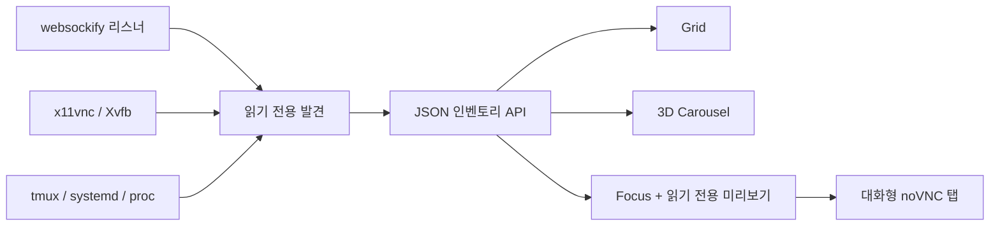

[English](../README.md) · [العربية](README.ar.md) · [Español](README.es.md) · [Français](README.fr.md) · [日本語](README.ja.md) · [한국어](README.ko.md) · [Tiếng Việt](README.vi.md) · [中文 (简体)](README.zh-Hans.md) · [中文（繁體）](README.zh-Hant.md) · [Deutsch](README.de.md) · [Русский](README.ru.md)

[](https://lazying.art)

# noVNC Session Manager

*Linux 워크스테이션의 모든 noVNC 데스크톱을 위한 하나의 세련된 로컬 제어 화면.*

[](https://www.python.org/)
[](https://www.kernel.org/)
[](https://github.com/novnc/noVNC)
[](../LICENSE)
[](https://github.com/sponsors/lachlanchen)

noVNC Session Manager는 실행 중인 `websockify`, VNC, X11/Xvfb, tmux,
systemd 관계를 동적으로 발견합니다. 여러 격리 가상 데스크톱을 검색 가능한
대시보드로 정리하고 상태 검사, 실행 출처, 읽기 전용 실시간 미리보기,
원클릭 대화형 열기를 제공합니다.

| Donate | PayPal | Stripe |
| --- | --- | --- |
| [](https://chat.lazying.art/donate) | [](https://paypal.me/RongzhouChen) | [](https://buy.stripe.com/aFadR8gIaflgfQV6T4fw400) |


<details>
<summary><strong>Compiz / Vista에서 영감을 받은 3D 캐러셀</strong></summary>


</details>

## 주요 기능

- **동적 발견** — 새로운 noVNC 리스너가 자동으로 나타나며 고정 목록이 필요 없습니다.
- **세 가지 목적형 보기** — 밀도 높은 Grid, 실시간 미리보기와 정보를 갖춘 Carousel, 큰 미리보기의 Focus.
- **저장되는 세 테마** — 기본 Vivid, 밝은 Bright, 차분한 Calm을 선택할 수 있습니다.
- **안전한 미리보기** — 한 번에 하나의 지연 로드 읽기 전용 VNC 연결만 엽니다.
- **출처 중심 상세 정보** — Web/VNC 포트, X display, 해상도, PID, 실행 시간,
  tmux pane, systemd unit, 런처와 프로젝트 위치를 표시합니다.
- **이중 상태 검사** — noVNC HTTP 프런트엔드와 VNC TCP 백엔드를 따로 확인합니다.
- **로컬 우선** — `127.0.0.1`에만 바인딩하며 발견된 데스크톱을 변경하지 않습니다.
- **데스크톱 통합** — 앱 메뉴 GUI와 로그인 전 실행 가능한 사용자 서비스를 설치합니다.

## 작동 방식



백엔드는 Python 표준 라이브러리와 일반적인 Linux 명령만 사용합니다. fork된
`websockify` worker를 하나의 엔드포인트로 묶고 VNC 백엔드와 X display를
추적한 뒤 tmux, systemd, 프로세스 메타데이터를 더합니다.
[`config.json`](../config.json)은 알려진 포트에 읽기 쉬운 이름과 용도를
덧붙이는 선택 설정이며, 등록되지 않은 엔드포인트도 그대로 표시됩니다.

## 빠른 시작

```bash
git clone https://github.com/lachlanchen/novnc-manager.git
cd novnc-manager
python3 server.py --host 127.0.0.1 --port 7080
```

<http://127.0.0.1:7080>을 엽니다.

GUI와 부팅 지속 사용자 서비스를 설치하려면:

```bash
chmod +x scripts/*.sh
./scripts/install-user-service.sh
```

그다음 애플리케이션 메뉴에서 **noVNC Session Manager**를 검색합니다.
설치기는 RDP/XRDP 세션에서도 올바른 systemd 사용자 버스를 사용합니다.
lingering이 꺼져 있으면 로그인 전 시작을 위한 명령을 안내합니다.

```bash
sudo loginctl enable-linger "$USER"
```

GUI 런처는 원격 데스크톱 합성 안정성을 위해 Google Chrome app mode와
소프트웨어 렌더링을 우선 사용하며, 없으면 `xdg-open`으로 대체합니다.

## 화면 모드

| 모드 | 적합한 용도 | 조작 |
| --- | --- | --- |
| **Grid** | 많은 세션을 동시에 확인 | 전체 폭의 조밀한 카드 |
| **Carousel** | Vista Flip 3D / Compiz식 탐색 | 휠, 클릭 또는 ← / → |
| **Focus** | 한 데스크톱 검사 | 큰 지연 로드 읽기 전용 미리보기 |

**Open ↗**은 완전한 대화형 noVNC 탭을 엽니다. 테마와 화면 선택은 브라우저에
저장되며 URL에서도 지정할 수 있습니다.

```text
http://127.0.0.1:7080/?view=carousel&theme=vivid
```

## 설정과 API

[`config.json`](../config.json)에서 알려진 포트의 이름, 설명, 프로젝트 경로,
우선순위를 지정할 수 있습니다. 모든 오버레이를 제거해도 동적 발견은 유지됩니다.

| 엔드포인트 | 용도 |
| --- | --- |
| `GET /healthz` | 가벼운 관리자 상태 검사 |
| `GET /api/instances` | 현재 세션 목록과 이중 상태 |

## 프로젝트 구성

| 경로 | 역할 |
| --- | --- |
| [`server.py`](../server.py) | 발견 엔진과 로컬 HTTP 서버 |
| [`static/`](../static/) | 반응형 대시보드, 테마와 보기 |
| [`config.json`](../config.json) | 선택적 사용자 친화 세션 메타데이터 |
| [`scripts/install-user-service.sh`](../scripts/install-user-service.sh) | 멱등 사용자 설치기 |
| [`scripts/open-manager.sh`](../scripts/open-manager.sh) | 견고한 데스크톱 GUI 런처 |
| [`packaging/`](../packaging/) | 이식 가능한 systemd / desktop-entry 템플릿 |

## 검증

```bash
bash -n scripts/*.sh
python3 -m py_compile server.py
python3 -m json.tool config.json >/dev/null
node --check static/app.js
curl --fail http://127.0.0.1:7080/healthz
curl --fail http://127.0.0.1:7080/api/instances | python3 -m json.tool
```

관리자는 의도적으로 관찰 전용입니다. 임의 프로세스에서 수명 주기 작업을
추측하면 잘못된 tmux pane이나 분리 프록시를 재시작해 앱 상태를 잃을 수 있습니다.

## 인용

연구에서 noVNC Session Manager를 사용한다면 이 저장소를 인용해 주세요.
GitHub는 [`CITATION.cff`](../CITATION.cff)를 읽어
**Cite this repository** 패널을 표시합니다.

```bibtex
@software{chen_novnc_manager_2026,
  author = {Chen, Lachlan},
  title = {noVNC Session Manager: A local control plane for virtual desktops},
  year = {2026},
  url = {https://github.com/lachlanchen/novnc-manager}
}
```

## 상태와 범위

`websockify`, noVNC, `x11vnc`, Xvfb, tmux, systemd 사용자 서비스,
Chrome app mode, XRDP, VNC에서 검증되었습니다. 인증이나 네트워크 접근 제어를
대체하지 않습니다. 보안 터널 또는 인증된 리버스 프록시가 없다면 관리자와
비인증 noVNC 엔드포인트를 localhost에만 두십시오.

[MIT License](../LICENSE)로 제공되는
[LazyingArt](https://lazying.art) 오픈소스 생태계의 일부입니다.
