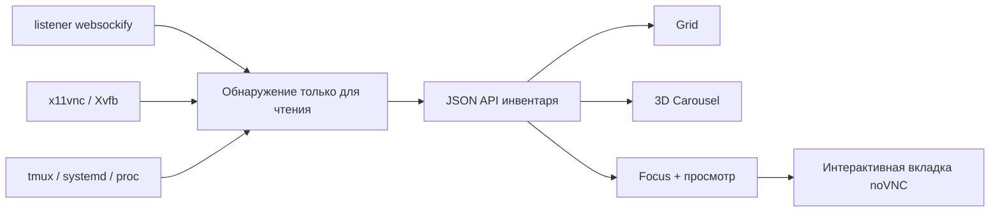

[English](../README.md) · [العربية](README.ar.md) · [Español](README.es.md) · [Français](README.fr.md) · [日本語](README.ja.md) · [한국어](README.ko.md) · [Tiếng Việt](README.vi.md) · [中文 (简体)](README.zh-Hans.md) · [中文（繁體）](README.zh-Hant.md) · [Deutsch](README.de.md) · [Русский](README.ru.md)

[](https://lazying.art)

# noVNC Session Manager

*Единая элегантная локальная панель для всех noVNC-рабочих столов Linux-станции.*

[](https://www.python.org/)
[](https://www.kernel.org/)
[](https://github.com/novnc/noVNC)
[](../LICENSE)
[](https://github.com/sponsors/lachlanchen)

noVNC Session Manager динамически обнаруживает связи между `websockify`, VNC,
X11/Xvfb, tmux и systemd. Множество изолированных виртуальных столов становится
понятной панелью с поиском, проверкой состояния, сведениями об источнике,
живым просмотром только для чтения и интерактивным открытием одним нажатием.

| Donate | PayPal | Stripe |
| --- | --- | --- |
| [](https://chat.lazying.art/donate) | [](https://paypal.me/RongzhouChen) | [](https://buy.stripe.com/aFadR8gIaflgfQV6T4fw400) |


<details>
<summary><strong>3D-карусель в духе Compiz и Vista</strong></summary>


</details>

## Возможности

- **Динамическое обнаружение** — новые noVNC-listener появляются без статического списка.
- **Три режима** — плотный Grid, Carousel с живым просмотром и сведениями, а также Focus с крупным просмотром.
- **Три сохраняемые темы** — Vivid по умолчанию, светлая Bright и спокойная Calm.
- **Безопасный просмотр** — одновременно загружается только одно VNC-соединение для чтения.
- **Сведения об источнике** — порты Web/VNC, X display, разрешение, PID, время работы,
  tmux pane, systemd unit, launcher и каталог проекта.
- **Двухуровневая проверка** — отдельно для HTTP-фронтенда noVNC и TCP-бэкенда VNC.
- **Локальный подход** — привязка только к `127.0.0.1`, без изменения найденных столов.
- **Интеграция с рабочим столом** — GUI в меню и пользовательская служба до входа.

## Архитектура



Бэкенд использует только стандартную библиотеку Python и обычные команды
Linux. Он группирует fork-процессы `websockify`, прослеживает прокси до VNC и
X display и добавляет метаданные tmux, systemd и процессов.
[`config.json`](../config.json) задаёт необязательные понятные имена и описания;
неизвестные конечные точки тоже отображаются.

## Быстрый старт

```bash
git clone https://github.com/lachlanchen/novnc-manager.git
cd novnc-manager
python3 server.py --host 127.0.0.1 --port 7080
```

Откройте <http://127.0.0.1:7080>.

Установка GUI и службы, запускаемой при загрузке:

```bash
chmod +x scripts/*.sh
./scripts/install-user-service.sh
```

Затем найдите **noVNC Session Manager** в меню приложений. Установщик использует
правильную пользовательскую шину systemd даже в RDP/XRDP. Если lingering не
включён, он покажет команду для запуска до входа:

```bash
sudo loginctl enable-linger "$USER"
```

Launcher предпочитает Google Chrome app mode с программным рендерингом для
стабильной удалённой композиции, иначе использует `xdg-open`.

## Режимы интерфейса

| Режим | Для чего | Управление |
| --- | --- | --- |
| **Grid** | Много сеансов одновременно | Компактные карточки на всю ширину |
| **Carousel** | Просмотр как Vista Flip 3D / Compiz | Колесо, щелчок или ← / → |
| **Focus** | Изучение одного стола | Большой отложенный просмотр только для чтения |

**Open ↗** открывает полностью интерактивную вкладку noVNC. Тема и режим
сохраняются в браузере и могут задаваться URL:

```text
http://127.0.0.1:7080/?view=carousel&theme=vivid
```

## Конфигурация и API

В [`config.json`](../config.json) можно задать имена, описания, каталоги и
приоритеты известных портов. Даже без переопределений обнаружение остаётся
динамическим.

| Endpoint | Назначение |
| --- | --- |
| `GET /healthz` | Лёгкая проверка менеджера |
| `GET /api/instances` | Текущий инвентарь и двухуровневое состояние |

## Структура проекта

| Путь | Роль |
| --- | --- |
| [`server.py`](../server.py) | Механизм обнаружения и локальный HTTP-сервер |
| [`static/`](../static/) | Адаптивная панель, темы и режимы |
| [`config.json`](../config.json) | Необязательные читаемые метаданные |
| [`scripts/install-user-service.sh`](../scripts/install-user-service.sh) | Идемпотентный пользовательский установщик |
| [`scripts/open-manager.sh`](../scripts/open-manager.sh) | Надёжный GUI-launcher |
| [`packaging/`](../packaging/) | Переносимые шаблоны systemd и desktop-entry |

## Проверка

```bash
bash -n scripts/*.sh
python3 -m py_compile server.py
python3 -m json.tool config.json >/dev/null
node --check static/app.js
curl --fail http://127.0.0.1:7080/healthz
curl --fail http://127.0.0.1:7080/api/instances | python3 -m json.tool
```

Менеджер намеренно остаётся наблюдателем. Он не угадывает команды жизненного
цикла по произвольным процессам: перезапуск неверного tmux pane или detached
proxy может уничтожить состояние приложения.

## Цитирование

При использовании noVNC Session Manager в исследовании цитируйте репозиторий.
GitHub читает [`CITATION.cff`](../CITATION.cff) и показывает панель
**Cite this repository**.

```bibtex
@software{chen_novnc_manager_2026,
  author = {Chen, Lachlan},
  title = {noVNC Session Manager: A local control plane for virtual desktops},
  year = {2026},
  url = {https://github.com/lachlanchen/novnc-manager}
}
```

## Статус и границы

Проверено с `websockify`, noVNC, `x11vnc`, Xvfb, tmux, пользовательскими
службами systemd, Chrome app mode, XRDP и VNC. Проект не заменяет
аутентификацию или контроль доступа. Держите менеджер и незащищённые endpoint
noVNC на localhost, если нет безопасного туннеля или авторизованного reverse proxy.

Проект распространяется по [лицензии MIT](../LICENSE) и входит в открытую
экосистему [LazyingArt](https://lazying.art).
