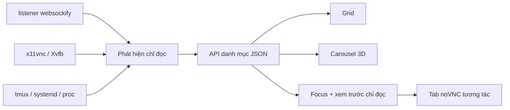

[English](../README.md) · [العربية](README.ar.md) · [Español](README.es.md) · [Français](README.fr.md) · [日本語](README.ja.md) · [한국어](README.ko.md) · [Tiếng Việt](README.vi.md) · [中文 (简体)](README.zh-Hans.md) · [中文（繁體）](README.zh-Hant.md) · [Deutsch](README.de.md) · [Русский](README.ru.md)

[](https://lazying.art)

# noVNC Session Manager

*Một bảng điều khiển cục bộ thanh lịch cho mọi desktop noVNC trên máy trạm Linux.*

[](https://www.python.org/)
[](https://www.kernel.org/)
[](https://github.com/novnc/noVNC)
[](../LICENSE)
[](https://github.com/sponsors/lachlanchen)

noVNC Session Manager tự động phát hiện quan hệ giữa `websockify`, VNC,
X11/Xvfb, tmux và systemd. Nhiều desktop ảo biệt lập được gom thành một bảng
điều khiển rõ ràng, có tìm kiếm, kiểm tra trạng thái, thông tin nguồn khởi chạy,
xem trước trực tiếp chỉ đọc và mở tương tác bằng một cú nhấp.

| Donate | PayPal | Stripe |
| --- | --- | --- |
| [](https://chat.lazying.art/donate) | [](https://paypal.me/RongzhouChen) | [](https://buy.stripe.com/aFadR8gIaflgfQV6T4fw400) |


<details>
<summary><strong>Carousel 3D lấy cảm hứng từ Compiz và Vista</strong></summary>


</details>

## Tính năng

- **Phát hiện động** — listener noVNC mới tự xuất hiện, không cần danh sách cố định.
- **Ba chế độ có mục đích** — Grid để xem dày, Carousel có bản xem trước và thông tin trực tiếp, Focus để xem lớn.
- **Ba giao diện được lưu** — Vivid là mặc định, Bright sáng rõ và Calm dành cho phong cách yên tĩnh.
- **Xem trước an toàn** — chỉ một kết nối VNC chỉ đọc được tải trễ tại một thời điểm.
- **Chi tiết nguồn** — cổng Web/VNC, X display, độ phân giải, PID, thời gian chạy,
  tmux pane, systemd unit, launcher và vị trí dự án.
- **Kiểm tra hai lớp** — kiểm tra riêng frontend HTTP noVNC và backend TCP VNC.
- **Ưu tiên cục bộ** — chỉ bind `127.0.0.1`, không thay đổi desktop đã phát hiện.
- **Tích hợp desktop** — launcher trong menu và dịch vụ người dùng chạy trước đăng nhập.

## Cách hoạt động



Backend chỉ dùng thư viện chuẩn Python và lệnh Linux phổ biến. Nó nhóm các
worker `websockify` được fork, lần theo proxy đến backend VNC và X display, rồi
bổ sung metadata tmux, systemd và tiến trình. [`config.json`](../config.json)
cung cấp tên và mô tả tùy chọn; endpoint chưa đăng ký vẫn được hiển thị.

## Bắt đầu nhanh

```bash
git clone https://github.com/lachlanchen/novnc-manager.git
cd novnc-manager
python3 server.py --host 127.0.0.1 --port 7080
```

Mở <http://127.0.0.1:7080>.

Cài GUI và dịch vụ tự chạy khi khởi động:

```bash
chmod +x scripts/*.sh
./scripts/install-user-service.sh
```

Sau đó tìm **noVNC Session Manager** trong menu ứng dụng. Trình cài đặt dùng
đúng systemd user bus ngay cả trong RDP/XRDP. Nếu lingering chưa bật, nó sẽ
hiển thị lệnh để chạy trước khi đăng nhập:

```bash
sudo loginctl enable-linger "$USER"
```

Launcher ưu tiên Google Chrome app mode với render bằng phần mềm để ổn định
desktop từ xa; nếu không có sẽ dùng `xdg-open`.

## Chế độ giao diện

| Chế độ | Phù hợp | Tương tác |
| --- | --- | --- |
| **Grid** | Xem nhiều phiên cùng lúc | Thẻ gọn trên toàn chiều rộng |
| **Carousel** | Duyệt kiểu Vista Flip 3D / Compiz | Con lăn, nhấp hoặc ← / → |
| **Focus** | Kiểm tra một desktop | Xem trước lớn, tải trễ, chỉ đọc |

**Open ↗** mở tab noVNC tương tác đầy đủ. Chủ đề và chế độ được lưu trong trình
duyệt, đồng thời có thể chọn qua URL:

```text
http://127.0.0.1:7080/?view=carousel&theme=vivid
```

## Cấu hình và API

Sửa [`config.json`](../config.json) để gắn tên, mô tả, đường dẫn dự án và độ ưu
tiên cho cổng quen thuộc. Việc phát hiện vẫn động khi bỏ toàn bộ ghi đè.

| Endpoint | Mục đích |
| --- | --- |
| `GET /healthz` | Kiểm tra nhẹ tình trạng manager |
| `GET /api/instances` | Danh mục hiện tại và trạng thái hai lớp |

## Bản đồ dự án

| Đường dẫn | Vai trò |
| --- | --- |
| [`server.py`](../server.py) | Bộ máy phát hiện và HTTP server cục bộ |
| [`static/`](../static/) | Dashboard đáp ứng, chủ đề và chế độ |
| [`config.json`](../config.json) | Metadata phiên dễ đọc tùy chọn |
| [`scripts/install-user-service.sh`](../scripts/install-user-service.sh) | Trình cài đặt người dùng idempotent |
| [`scripts/open-manager.sh`](../scripts/open-manager.sh) | Launcher GUI bền vững |
| [`packaging/`](../packaging/) | Mẫu systemd và desktop-entry di động |

## Xác thực

```bash
bash -n scripts/*.sh
python3 -m py_compile server.py
python3 -m json.tool config.json >/dev/null
node --check static/app.js
curl --fail http://127.0.0.1:7080/healthz
curl --fail http://127.0.0.1:7080/api/instances | python3 -m json.tool
```

Manager cố ý chỉ quan sát. Nó không suy đoán thao tác vòng đời từ tiến trình tùy
ý, vì khởi động lại nhầm tmux pane hoặc proxy tách rời có thể làm mất trạng thái.

## Trích dẫn

Nếu dùng noVNC Session Manager trong nghiên cứu, hãy trích dẫn kho này. GitHub
đọc [`CITATION.cff`](../CITATION.cff) và hiển thị
**Cite this repository**.

```bibtex
@software{chen_novnc_manager_2026,
  author = {Chen, Lachlan},
  title = {noVNC Session Manager: A local control plane for virtual desktops},
  year = {2026},
  url = {https://github.com/lachlanchen/novnc-manager}
}
```

## Trạng thái và phạm vi

Đã thử nghiệm với `websockify`, noVNC, `x11vnc`, Xvfb, tmux, systemd user
service, Chrome app mode, XRDP và VNC. Dự án không thay thế xác thực hay kiểm
soát truy cập. Hãy giữ manager và endpoint noVNC không xác thực trên localhost,
trừ khi dùng tunnel an toàn hoặc reverse proxy có xác thực.

Phát hành theo [MIT License](../LICENSE), thuộc hệ sinh thái mã nguồn mở
[LazyingArt](https://lazying.art).
