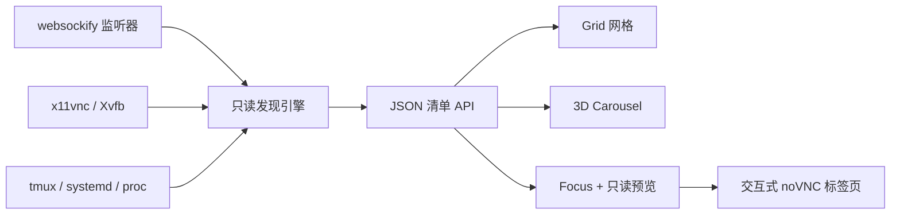

[English](../README.md) · [العربية](README.ar.md) · [Español](README.es.md) · [Français](README.fr.md) · [日本語](README.ja.md) · [한국어](README.ko.md) · [Tiếng Việt](README.vi.md) · [中文 (简体)](README.zh-Hans.md) · [中文（繁體）](README.zh-Hant.md) · [Deutsch](README.de.md) · [Русский](README.ru.md)

[](https://lazying.art)

# noVNC Session Manager

*为 Linux 工作站上的所有 noVNC 桌面提供一个优雅的本地控制中心。*

[](https://www.python.org/)
[](https://www.kernel.org/)
[](https://github.com/novnc/noVNC)
[](../LICENSE)
[](https://github.com/sponsors/lachlanchen)

noVNC Session Manager 会动态发现正在运行的 `websockify`、VNC、X11/Xvfb、
tmux 与 systemd 之间的关系。它把散落在工作站上的隔离虚拟桌面整理成清晰、
可搜索的面板，并提供健康检查、来源说明、只读实时预览和一键交互式打开。

| Donate | PayPal | Stripe |
| --- | --- | --- |
| [](https://chat.lazying.art/donate) | [](https://paypal.me/RongzhouChen) | [](https://buy.stripe.com/aFadR8gIaflgfQV6T4fw400) |


<details>
<summary><strong>受 Compiz / Vista 启发的 3D 轮播视图</strong></summary>


</details>

## 主要能力

- **动态发现**：新出现的 noVNC 监听端口会自动加入，无需维护固定清单。
- **三种视图**：Grid 适合高密度总览，Carousel 提供实时预览与会话信息，Focus 提供大型实时预览。
- **三套持久主题**：默认使用 Vivid，也可切换到明亮的 Bright 或安静的 Calm。
- **安全预览**：同一时间只懒加载一个只读 VNC 连接。
- **来源信息完整**：显示 Web/VNC 端口、X display、分辨率、PID、运行时间、
  tmux pane、systemd unit、启动器和项目位置。
- **双层健康检查**：分别测试 noVNC HTTP 前端与底层 VNC TCP 后端。
- **本地优先**：仅绑定 `127.0.0.1`，不会停止、重启或修改被发现的桌面。
- **桌面集成**：可安装应用菜单入口和登录前即可运行的 systemd 用户服务。

## 工作方式



后端只使用 Python 标准库和常见 Linux 命令。它会把 fork 出来的
`websockify` worker 合并为一个端点，追踪到 VNC 后端与 X display，再补充
tmux、systemd 和进程信息。[`config.json`](../config.json) 可为稳定端口添加
易读名称与用途；未登记端点仍会自动显示。

## 快速开始

```bash
git clone https://github.com/lachlanchen/novnc-manager.git
cd novnc-manager
python3 server.py --host 127.0.0.1 --port 7080
```

打开 <http://127.0.0.1:7080>。

安装 GUI 和开机自动运行的用户服务：

```bash
chmod +x scripts/*.sh
./scripts/install-user-service.sh
```

随后在应用菜单中搜索 **noVNC Session Manager**。安装器在 RDP/XRDP 会话中
也会使用正确的 systemd 用户总线。如果尚未启用 lingering，它会提示运行：

```bash
sudo loginctl enable-linger "$USER"
```

GUI 启动器优先使用 Google Chrome app mode 和软件渲染，以提高远程桌面合成的
稳定性；没有 Chrome 时会回退到 `xdg-open`。

## 界面模式

| 模式 | 最适合 | 操作方式 |
| --- | --- | --- |
| **Grid** | 一次查看大量会话 | 充分利用全宽的紧凑卡片 |
| **Carousel** | 像 Vista Flip 3D / Compiz 一样浏览 | 滚轮、点击或 ← / → |
| **Focus** | 检查单个桌面 | 大型懒加载只读预览 |

点击 **Open ↗** 可在新标签页中获得完整交互。主题和视图选择保存在浏览器本地，
也可通过 URL 指定：

```text
http://127.0.0.1:7080/?view=carousel&theme=vivid
```

## 配置与 API

编辑 [`config.json`](../config.json) 可为端口配置名称、说明、项目路径和排序优先级。
即使删除全部覆盖项，动态扫描仍然有效。

| 端点 | 用途 |
| --- | --- |
| `GET /healthz` | 轻量管理器健康检查 |
| `GET /api/instances` | 当前会话清单及双层健康状态 |

## 项目结构

| 路径 | 作用 |
| --- | --- |
| [`server.py`](../server.py) | 发现引擎与本地 HTTP 服务器 |
| [`static/`](../static/) | 响应式面板、主题和视图模式 |
| [`config.json`](../config.json) | 可选的人类可读会话元数据 |
| [`scripts/install-user-service.sh`](../scripts/install-user-service.sh) | 幂等用户安装器 |
| [`scripts/open-manager.sh`](../scripts/open-manager.sh) | 稳健的桌面 GUI 启动器 |
| [`packaging/`](../packaging/) | 可移植的 systemd 与 desktop-entry 模板 |

## 验证

```bash
bash -n scripts/*.sh
python3 -m py_compile server.py
python3 -m json.tool config.json >/dev/null
node --check static/app.js
curl --fail http://127.0.0.1:7080/healthz
curl --fail http://127.0.0.1:7080/api/instances | python3 -m json.tool
```

管理器刻意保持观察模式。它不会从任意进程猜测生命周期操作，因为错误重启
tmux pane 或分离代理可能破坏应用状态。

## 引用

若在研究中使用 noVNC Session Manager，请引用本仓库。GitHub 会读取
[`CITATION.cff`](../CITATION.cff) 并显示 **Cite this repository** 面板。

```bibtex
@software{chen_novnc_manager_2026,
  author = {Chen, Lachlan},
  title = {noVNC Session Manager: A local control plane for virtual desktops},
  year = {2026},
  url = {https://github.com/lachlanchen/novnc-manager}
}
```

## 状态与范围

本项目已在 `websockify`、noVNC、`x11vnc`、Xvfb、tmux、systemd 用户服务、
Chrome app mode、XRDP 和 VNC 环境中运行验证。它不替代身份验证或网络访问
控制；除非使用安全隧道或带认证的反向代理，否则请保持管理器和无认证 noVNC
端点仅监听本机。

项目采用 [MIT License](../LICENSE)，属于
[LazyingArt](https://lazying.art) 开源生态。
