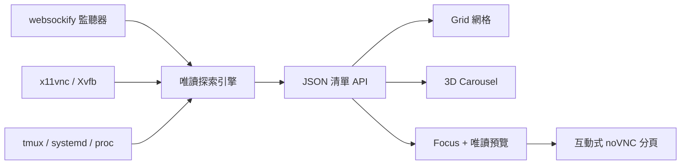

[English](../README.md) · [العربية](README.ar.md) · [Español](README.es.md) · [Français](README.fr.md) · [日本語](README.ja.md) · [한국어](README.ko.md) · [Tiếng Việt](README.vi.md) · [中文 (简体)](README.zh-Hans.md) · [中文（繁體）](README.zh-Hant.md) · [Deutsch](README.de.md) · [Русский](README.ru.md)

[](https://github.com/lachlanchen/lachlanchen/blob/main/figs/banner.png)

# noVNC Session Manager

*為 Linux 工作站上的所有 noVNC 桌面提供一個優雅的本機控制中心。*

[](https://www.python.org/)
[](https://www.kernel.org/)
[](https://github.com/novnc/noVNC)
[](../LICENSE)
[](https://github.com/sponsors/lachlanchen)

noVNC Session Manager 會動態探索執行中的 `websockify`、VNC、X11/Xvfb、
tmux 與 systemd 關係，把散落於工作站上的隔離虛擬桌面整理成清楚、可搜尋的
儀表板，並提供健康檢查、來源脈絡、唯讀即時預覽與一鍵互動開啟。

| Donate | PayPal | Stripe |
| --- | --- | --- |
| [](https://chat.lazying.art/donate) | [](https://paypal.me/RongzhouChen) | [](https://buy.stripe.com/aFadR8gIaflgfQV6T4fw400) |


<details>
<summary><strong>受 Compiz / Vista 啟發的 3D 輪播視圖</strong></summary>


</details>

## 主要能力

- **動態探索**：新的 noVNC 監聽器會自動出現，不需要固定清單。
- **三種視圖**：Grid 用於密集總覽，Carousel 提供即時預覽與工作階段資訊，Focus 提供大型即時預覽。
- **三套持久主題**：預設使用 Vivid，也可切換至明亮的 Bright 或安靜的 Calm。
- **安全預覽**：同一時間只延遲載入一個唯讀 VNC 連線。
- **完整來源資訊**：Web/VNC 埠、X display、畫面尺寸、PID、運行時間、
  tmux pane、systemd unit、啟動器與專案位置。
- **雙層健康檢查**：分別測試 noVNC HTTP 前端與 VNC TCP 後端。
- **本機優先**：只綁定 `127.0.0.1`，不會停止、重啟或修改任何桌面。
- **桌面整合**：可安裝應用程式入口與登入前即可運行的 systemd 使用者服務。

## 運作方式



後端只使用 Python 標準函式庫與常見 Linux 指令。它會將 fork 的
`websockify` worker 合併為單一端點，追蹤 VNC 後端與 X display，並加入
tmux、systemd 和程序資訊。[`config.json`](../config.json) 可為穩定埠加入
易讀名稱與用途；未登記端點仍會自動顯示。

## 快速開始

```bash
git clone https://github.com/lachlanchen/novnc-manager.git
cd novnc-manager
python3 server.py --host 127.0.0.1 --port 7080
```

開啟 <http://127.0.0.1:7080>。

安裝 GUI 與開機自動執行的使用者服務：

```bash
chmod +x scripts/*.sh
./scripts/install-user-service.sh
```

之後在應用程式選單搜尋 **noVNC Session Manager**。安裝器在 RDP/XRDP
工作階段中也會使用正確的 systemd 使用者匯流排；若尚未啟用 lingering，
它會提示執行：

```bash
sudo loginctl enable-linger "$USER"
```

GUI 啟動器優先採用 Google Chrome app mode 與軟體渲染，以提升遠端桌面合成
穩定性；沒有 Chrome 時則使用 `xdg-open`。

## 介面模式

| 模式 | 最適合 | 操作 |
| --- | --- | --- |
| **Grid** | 同時查看大量工作階段 | 充分運用全寬的緊湊卡片 |
| **Carousel** | 像 Vista Flip 3D / Compiz 般瀏覽 | 滾輪、點擊或 ← / → |
| **Focus** | 檢查單一桌面 | 大型延遲載入唯讀預覽 |

選擇 **Open ↗** 會開啟完整互動式 noVNC 分頁。主題與視圖會保存在瀏覽器，
也可以 URL 指定：

```text
http://127.0.0.1:7080/?view=carousel&theme=vivid
```

## 設定與 API

編輯 [`config.json`](../config.json) 可為連接埠設定名稱、說明、專案路徑與排序
優先度。即使移除所有覆寫設定，動態探索仍然有效。

| 端點 | 用途 |
| --- | --- |
| `GET /healthz` | 輕量管理器健康檢查 |
| `GET /api/instances` | 目前工作階段清單與雙層健康狀態 |

## 專案結構

| 路徑 | 角色 |
| --- | --- |
| [`server.py`](../server.py) | 探索引擎與本機 HTTP 伺服器 |
| [`static/`](../static/) | 響應式儀表板、主題與視圖 |
| [`config.json`](../config.json) | 選用的人類可讀工作階段中繼資料 |
| [`scripts/install-user-service.sh`](../scripts/install-user-service.sh) | 冪等使用者安裝器 |
| [`scripts/open-manager.sh`](../scripts/open-manager.sh) | 穩健的桌面 GUI 啟動器 |
| [`packaging/`](../packaging/) | 可移植 systemd 與 desktop-entry 範本 |

## 驗證

```bash
bash -n scripts/*.sh
python3 -m py_compile server.py
python3 -m json.tool config.json >/dev/null
node --check static/app.js
curl --fail http://127.0.0.1:7080/healthz
curl --fail http://127.0.0.1:7080/api/instances | python3 -m json.tool
```

管理器刻意保持觀察模式。它不會從任意程序猜測生命週期操作，因為錯誤重啟
tmux pane 或分離代理可能破壞應用程式狀態。

## 引用

若在研究中使用 noVNC Session Manager，請引用本儲存庫。GitHub 會讀取
[`CITATION.cff`](../CITATION.cff) 並顯示 **Cite this repository** 面板。

```bibtex
@software{chen_novnc_manager_2026,
  author = {Chen, Lachlan},
  title = {noVNC Session Manager: A local control plane for virtual desktops},
  year = {2026},
  url = {https://github.com/lachlanchen/novnc-manager}
}
```

## 狀態與範圍

本專案已在 `websockify`、noVNC、`x11vnc`、Xvfb、tmux、systemd 使用者服務、
Chrome app mode、XRDP 與 VNC 環境中測試。它不取代驗證或網路存取控制；
除非使用安全隧道或具驗證的反向代理，否則請讓管理器和無驗證 noVNC 端點
只監聽本機。

採用 [MIT License](../LICENSE)，屬於
[LazyingArt](https://lazying.art) 開源生態。
